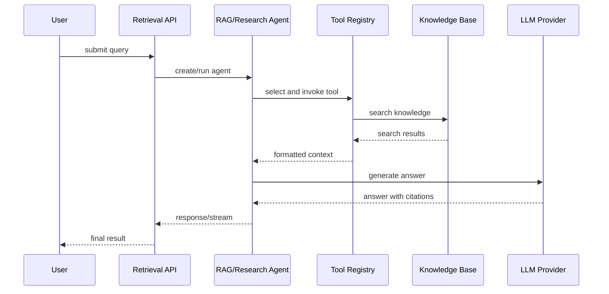

# R2R 五天 Agent 岗位快速学习与简历产出计划

> 学习对象：[`SciPhi-AI/R2R`](https://github.com/SciPhi-AI/R2R)
>
> 目标：在 5 天内跑通 R2R 的 Agentic RAG 主链路，完成至少一个可展示的二次开发功能，并形成可写入 AI Agent 开发工程师简历的项目材料。
>
> 推荐投入：每天 4–6 小时。如果每天只能投入 2–3 小时，优先完成标记为 **必须** 的任务。

## 最终目标

5 天结束时，应能完成以下交付物：

- 能独立启动 R2R 本地源码开发环境；
- 能解释从请求进入到 Agent 返回结果的主要调用链；
- 能说明 `RAGAgent`、`ResearchAgent`、`ToolRegistry` 和 Provider 的职责；
- 完成一个 Agent 相关的代码改造；
- 为改造添加测试或可重复验证脚本；
- 获得至少一组 baseline 与改进后的数据；
- 完成项目架构图、改造说明和简历表述；
- 能在 3 分钟内向面试官讲清楚项目、个人贡献和技术取舍。

## 推荐项目定位

不要把项目描述成“部署并使用了 R2R”。建议将个人版本定位为：

> 面向企业知识库的可观测 Agentic RAG 系统：支持文档检索、Agent 工具调用、引用追踪和 Agent 运行评测。

在简历中必须明确区分：

- R2R 原有能力；
- 你自己阅读、修改和新增的内容；
- 你的实验数据和测试范围；
- 尚未完成的能力，不要夸大为已实现。

---

# 第 1 天：环境、系统验证与最小 Demo

## 目标

跑通本地源码服务，完成最小闭环：

```text
启动 R2R
  → 上传 sample.txt
  → 执行检索
  → 执行 RAG 问答
  → 记录响应和错误
```

## 必须完成

### 1. 安装和确认环境

推荐环境：

```text
Windows + WSL2 或 Linux
Python 3.12
uv
Docker Desktop / Docker Engine
PostgreSQL + pgvector
```

进入项目的 Python 目录：

```bash
cd R2R/py
uv venv --python 3.12
uv sync --extra core --group dev
```

确认导入：

```bash
uv run python -c "import core, r2r; print('R2R import ok')"
uv run pip check
```

### 2. 启动数据库

在仓库根目录执行：

```bash
docker compose -f docker/compose.yaml --profile postgres up -d postgres
```

检查：

```bash
docker compose -f docker/compose.yaml ps postgres
```

### 3. 配置环境变量

本地源码连接 Docker PostgreSQL 时，数据库主机使用 `localhost`：

```bash
export OPENAI_API_KEY="你的_API_KEY"
export R2R_POSTGRES_HOST=localhost
export R2R_POSTGRES_PORT=5432
export R2R_POSTGRES_USER=postgres
export R2R_POSTGRES_PASSWORD=postgres
export R2R_POSTGRES_DBNAME=postgres
export R2R_PROJECT_NAME=r2r_default
```

不要把真实 API Key 提交到 Git。

### 4. 启动源码服务

```bash
cd R2R/py
uv run python -m r2r.serve
```

另开终端验证：

```bash
curl -i http://localhost:7272/v3/health
```

打开：

```text
http://localhost:7272/docs
```

## 产出

创建学习记录：

```text
notes/day-1-runtime.md
```

记录：

- 实际 Python、uv、Docker 版本；
- 启动命令；
- 数据库配置；
- 健康检查结果；
- 一次成功请求和一次失败请求；
- 主要错误及解决方法。

## 完成标志

- `/v3/health` 返回 HTTP 200；
- `/docs` 可以打开；
- `core` 和 `r2r` 的导入路径指向本地源码；
- 至少完成一次文本文件上传和一次检索/RAG 请求。

---

# 第 2 天：只读懂 Agent 主链路

## 目标

不通读整个仓库，只建立 Agent 岗位最需要的架构理解。

## 必读文件顺序

```text
py/r2r/serve.py
py/core/main/app_entry.py
py/core/main/app.py
py/core/main/config.py
py/core/main/assembly/
py/core/main/api/v3/retrieval_router.py
py/core/agent/base.py
py/core/agent/rag.py
py/core/agent/research.py
py/core/base/agent/tools/registry.py
py/core/providers/llm/
py/core/providers/database/
```

## 重点回答的问题

### 启动和请求流

画出：

```text
r2r.serve
  → R2RConfig
  → R2RBuilder
  → R2RApp
  → retrieval_router
  → Agent
  → LLM / Database Provider
  → JSON 或流式响应
```

### RAG Agent

确认并记录：

- `RAGAgentMixin` 提供哪些能力；
- `R2RRAGAgent` 与 Streaming Agent 的差异；
- `knowledge_search_method`、`content_method`、`file_search_method` 的作用；
- `ToolRegistry` 如何注册工具；
- 搜索结果如何被格式化为 LLM 上下文；
- 上下文长度如何被限制；
- 引用如何关联到搜索结果。

### Research Agent

画出：

```text
Research Agent
  ├── rag
  ├── reasoning
  ├── critique
  └── python_executor
```

特别记录：

- Research Agent 如何复用 RAG Agent；
- `max_iterations` 如何限制循环；
- Python executor 当前有哪些超时和安全限制；
- RAG Agent 的引用结果如何回传给 Research Agent。

## 产出

创建：

```text
docs/agent-call-flow.md
docs/tool-registry-notes.md
docs/research-agent-flow.md
```

至少包含一张 Mermaid 图，例如：



## 完成标志

你可以不看代码回答：

1. RAG Agent 和普通 LLM 调用的区别；
2. Tool Registry 解决什么问题；
3. Research Agent 比 RAG Agent 多了什么；
4. Agent 如何防止无限迭代；
5. 工具结果如何进入上下文；
6. 当前 Python executor 为什么还不能直接视为安全沙箱。

---

# 第 3 天：选择并实现一个 Agent 改造

## 目标

完成一个范围可控、能体现 Agent 工程能力的功能。不要同时修改多个大型模块。

## 首选方案：新增一个结构化 Agent 工具

推荐实现：`document_compare` 或 `summarize_sources`。

### 方案 A：document_compare

功能：

```text
接收两个文档标识或两个查询主题
  → 分别检索相关内容
  → 提取关键差异
  → 调用 LLM 生成结构化比较结果
  → 返回来源和引用
```

### 方案 B：summarize_sources

功能：

```text
接收用户问题
  → 调用知识库检索
  → 对多个来源分别生成摘要
  → 合并为结构化结果
  → 保留来源引用
```

## 实现任务

1. 定义工具名称和描述；
2. 定义 JSON 参数 Schema；
3. 实现参数校验；
4. 实现工具执行函数；
5. 将工具接入 `ToolRegistry` 或现有 Agent 配置；
6. 添加错误处理和超时；
7. 保留引用信息；
8. 添加至少 3 个测试场景：
   - 正常请求；
   - 参数缺失或非法；
   - 检索为空或下游服务失败。

## 推荐改造范围

优先查看：

```text
py/core/base/agent/tools/
py/core/agent/rag.py
py/core/agent/research.py
py/tests/
```

如果新增工具需要改动过多，改为实现一个独立的 Agent 评测脚本，不要为了赶时间大规模重构核心 Agent。

## 产出

```text
features/document_compare.md
scripts/evaluate_agent.py
tests/test_document_compare.py
```

至少记录：

- 原始行为；
- 改造设计；
- 新增文件和修改文件；
- 一个成功案例；
- 两个失败案例；
- 你做出的技术取舍。

## 完成标志

- 新工具能被 Agent 调用；
- 参数错误不会导致服务崩溃；
- 至少有 3 个自动化测试或可重复脚本；
- 能展示一次包含工具调用和引用的完整运行结果。

---

# 第 4 天：评测、可观测性和量化结果

## 目标

把“我改了一个 Agent 工具”变成“我能证明改造有效”。

## 任务一：建立小型评测集

创建：

```text
evaluation/questions.jsonl
```

准备 10–20 条问题，覆盖：

- 单文档事实查询；
- 多文档比较；
- 无答案问题；
- 需要多次检索的问题；
- 需要引用的问题。

每条数据至少包含：

```json
{
  "question": "问题内容",
  "expected_keywords": ["关键词1", "关键词2"],
  "expected_sources": ["sample.txt"]
}
```

## 任务二：记录 Agent 指标

至少记录：

```text
Task Success Rate
Tool Call Success Rate
Citation Coverage
Recall@K 或简单关键词召回率
Average Latency
Token Usage（如果可获得）
Failure Count
```

如果时间不足，至少完成：

```text
成功率 + 工具调用成功率 + 平均延迟 + 引用覆盖率
```

## 任务三：对比 baseline 和改进版本

输出：

```text
evaluation/baseline.json
evaluation/improved.json
evaluation/report.md
```

报告格式：

| 指标 | Baseline | 改进后 | 变化 |
|---|---:|---:|---:|
| 任务成功率 | X% | Y% | +Z 个百分点 |
| 工具调用成功率 | X% | Y% | +Z 个百分点 |
| 引用覆盖率 | X% | Y% | +Z 个百分点 |
| 平均延迟 | X ms | Y ms | Z% |

不要伪造指标。如果只有手工测试，应明确写成“在 N 条手工测试集上的结果”。

## 任务四：记录 Agent Trace

如果短时间内不能接入完整 OpenTelemetry，至少在本地记录：

```json
{
  "question": "...",
  "tools": ["search_file_knowledge", "get_file_content"],
  "iterations": 2,
  "latency_ms": 1800,
  "citations": ["doc-1"],
  "status": "success"
}
```

## 产出

```text
evaluation/report.md
observability/agent-run-example.json
```

## 完成标志

你能用数字回答：

- 改造前后有什么差异；
- 工具调用是否更稳定；
- 是否增加了延迟或成本；
- 哪些问题仍然失败；
- 评测结果有哪些局限。

---

# 第 5 天：整理项目、简历和面试材料

## 目标

将代码和实验整理成一个能展示、能解释、能写进简历的项目。

## 任务一：完善 README

README 至少包含：

1. 项目背景；
2. 系统架构；
3. Agent 工作流；
4. R2R 原有能力；
5. 个人改造内容；
6. 测试方法；
7. 实验结果；
8. 本地启动方式；
9. 已知限制；
10. 后续规划。

## 任务二：准备架构图和演示

准备一张架构图：

```text
Client
  → FastAPI Retrieval API
  → RAG/Research Agent
  → Tool Registry
  → PostgreSQL/pgvector
  → LLM Provider
  → Citation/Trace
```

准备一个 2–3 分钟演示：

1. 启动服务；
2. 上传文档；
3. 提问；
4. 展示 Agent 工具调用；
5. 展示引用；
6. 展示你的改造功能；
7. 展示评测结果。

## 任务三：准备简历表述

根据真实结果选择，不要直接照抄指标。

### 简历模板 1：Agentic RAG

> 基于 Python、FastAPI、PostgreSQL/pgvector �� LLM Provider 构建 Agentic RAG 知识库系统，设计知识库检索、内容获取和结构化 Agent 工具，实现带引用的检索增强问答。

### 简历模板 2：工具调用改造

> 基于 R2R 的 Tool Registry 扩展 `document_compare` 工具，完成参数 Schema、错误处理、引用传递和自动化测试，在 N 条测试样例上实现工具调用成功率 X%。

### 简历模板 3：Agent 评测

> 建立包含 N 条问题的 Agent 评测集，跟踪任务成功率、工具调用成功率、引用覆盖率和平均延迟，定位并修复 X 类工具调用失败问题。

### 简历模板 4：Research Agent

> 分析并扩展 Research Agent 的多步骤工具工作流，理解 RAG、reasoning、critique 和 Python executor 的组合方式，并通过最大迭代次数、超时和错误处理控制 Agent 运行风险。

### 简历模板 5：工程化

> 使用 `uv`、Docker Compose、PostgreSQL/pgvector 和 FastAPI 搭建可复现的本地 Agent 开发环境，完成源码调试、接口验证和自动化测试流程。

## 任务四：准备面试回答

必须能回答：

1. RAG Agent 和普通 LLM 调用有什么区别？
2. Tool Registry 为什么需要单独抽象？
3. RAG Agent 和 Research Agent 如何复用代码？
4. 如何防止 Agent 无限循环？
5. 如何评测 Agent 的工具选择？
6. 如何降低 Agent 延迟和 Token 成本？
7. Python executor 当前有哪些安全风险？
8. 如果改造成多智能体系统，你如何拆分 Planner、Researcher、Writer 和 Reviewer？
9. 如何设计短期记忆、工作记忆和长期记忆？
10. 如果上线，还需要补充哪些权限、监控和安全能力？

## 完成标志

- README 能在 3 分钟内讲清楚项目；
- 有架构图；
- 有一次录屏或可复现演示；
- 有真实测试数据；
- 有明确的个人贡献列表；
- 能区分原项目能力和自己的改造。

---

# 五天时间分配总表

| 天数 | 重点 | 必须产出 |
|---|---|---|
| 第 1 天 | 环境和最小闭环 | 服务运行、上传、Search/RAG 验证 |
| 第 2 天 | Agent 架构理解 | Agent 调用链、Tool Registry、Research Agent 笔记 |
| 第 3 天 | Agent 功能改造 | 一个新工具或一个可运行扩展 |
| 第 4 天 | 评测和量化 | 评测集、baseline/improved 数据、报告 |
| 第 5 天 | 简历和面试 | README、架构图、简历条目、演示流程 |

# 取舍原则

如果时间不够，按照以下优先级执行：

```text
1. 跑通服务和 RAG
2. 理解 RAG Agent、Research Agent、Tool Registry
3. 完成一个小而完整的 Agent 改造
4. 添加测试和真实数据
5. 整理 README 和简历
6. 最后再考虑完整 Docker、Kubernetes 和前端
```

五天内不要优先做：

- 重写整个 Agent 框架；
- 完整多智能体系统；
- 大规模前端改造；
- Kubernetes 生产部署；
- 自己训练 Embedding 或 LLM；
- 没有指标支撑的性能优化；
- 直接声称实现了“生产级安全沙箱”。

# 简历使用注意事项

可以写：

> 基于 R2R 开源框架进行二次开发，负责 Agent 工具扩展、评测和工程化验证。

不建议写：

> 独立开发 R2R 生产级 Agent 平台。

除非你确实实现了对应系统并能解释每个关键模块。面试时最重要的是诚实说明：

- 开源项目提供了哪些基础能力；
- 你读懂了哪些模块；
- 你具体修改了哪些文件；
- 你增加了哪些测试；
- 结果如何；
- 还有哪些未完成的工作。
